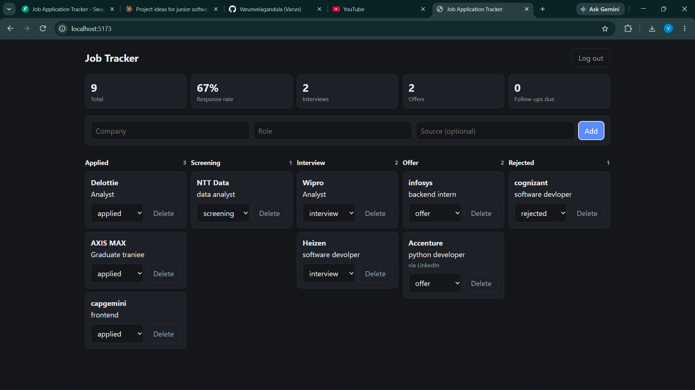

# Job Application Tracker

## Live demo

- App: https://jobtracker-web-1qj7.onrender.com
- API docs: https://job-application-tracker-api-xaff.onrender.com/docs
- Demo login: `demo@example.com` / `Demo12345`

Note: this runs on free hosting. The first load can take about a minute while the server wakes up, and the demo database may be reset from time to time.

A full-stack app for tracking job applications through stages (applied, screening, interview, offer, rejected), with a React dashboard and a FastAPI backend.

**Stack:** FastAPI, SQLAlchemy, SQLite/PostgreSQL, JWT auth, React (Vite), pytest, GitHub Actions, Docker.

## Features
- Register and log in with JWT authentication
- Each user sees only their own applications
- Create, search, filter, update and delete applications
- Every status change is stored in a history table
- Analytics endpoint: totals, counts per stage, response rate, follow-ups due
- React board with stage columns and a stats bar
- 6 automated tests that run on every push

## Run the backend
    python -m venv .venv
    .venv\Scripts\activate          (Mac/Linux: source .venv/bin/activate)
    pip install -r requirements.txt
    python -m uvicorn app.main:app --reload
API docs: http://127.0.0.1:8000/docs

## Run the frontend (second terminal)
    cd frontend
    npm install
    npm run dev
Open http://localhost:5173

## Run the tests
    python -m pytest -q

## API overview
| Method | Path | Purpose |
|---|---|---|
| POST | /auth/register, /auth/login | get a JWT |
| POST, GET | /applications | create, list (filter, search, paginate) |
| GET, PATCH, DELETE | /applications/{id} | read, update, delete |
| GET | /analytics/summary | stats for the dashboard |

## Design notes
- `status_events` records every status change, so time-in-stage analytics can be added later.
- All queries are scoped to the logged-in user; other users get a 404.
- The frontend proxies `/api` to the backend, so no CORS setup is needed in development.

## Roadmap
- Alembic migrations
- Frontend tests
- Live deployment